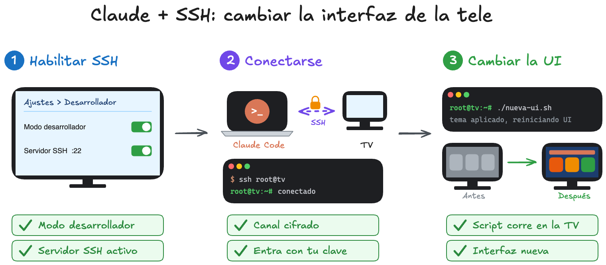

# Claude Code + SSH: cambiar la interfaz de tu tele



Tu tele es, en el fondo, una computadora chiquita: tiene un procesador, memoria, un sistema operativo (casi siempre basado en Linux) y una interfaz gráfica que corre arriba de todo eso. Si lográs entrar a esa computadora por SSH, podés pedirle a **Claude Code** que escriba y ejecute scripts que cambien lo que se ve en pantalla.

Esta guía explica el proceso en tres pasos:

1. **Habilitar SSH** en el panel de configuración de la tele.
2. **Conectarse** desde tu computadora con la terminal (o con Claude Code).
3. **Cambiar la UI** con scripts que corren dentro de la tele.

> El diagrama está hecho en Excalidraw. El archivo fuente está en [`assets/ssh-tv-interfaz.excalidraw`](assets/ssh-tv-interfaz.excalidraw) y lo podés abrir en [excalidraw.com](https://excalidraw.com).

---

## Índice

- [Paso 0: conocé tu tele](#paso-0-conocé-tu-tele)
- [Paso 1: habilitar SSH](#paso-1-habilitar-ssh)
- [Paso 2: conectarse desde tu computadora](#paso-2-conectarse-desde-tu-computadora)
- [Paso 3: cambiar la interfaz con scripts](#paso-3-cambiar-la-interfaz-con-scripts)
- [Buenas prácticas](#buenas-prácticas)

---

## Paso 0: conocé tu tele

Todo depende del modelo. Antes de tocar nada hay que saber **qué computadora hay adentro de la tele** y **qué sistema operativo corre**.

### 1. Buscá el código de modelo

Cada tele tiene un código de modelo, por ejemplo `OLED55C1PSA` o `UN55TU8000`. Lo encontrás en:

- La **etiqueta de atrás** de la tele.
- **Ajustes > Acerca de** (o *Soporte > Información del producto*).
- La caja o la factura.

Con ese código, buscá en la página del fabricante o en internet: `<código de modelo> sistema operativo`. Ahí vas a ver si corre webOS, Tizen, Android TV, Google TV u otro sistema, y en qué versión.

### 2. Mirá qué sistema operativo corre

| Sistema | Marcas típicas | Cómo se accede | Qué se puede cambiar |
|---|---|---|---|
| **LibreELEC / OSMC** (Linux con Kodi) | Raspberry Pi, TV boxes | SSH real, usuario `root` | Casi todo: skins, temas, scripts del sistema |
| **LG webOS** | LG | SSH en modo desarrollador (puerto `9922`, usuario `prisoner`) | Instalar tus propias apps; el sistema queda bloqueado sin root |
| **Android TV / Google TV** | Sony, TCL, Philips, Chromecast | ADB (`adb connect`), no SSH. Para SSH real, Termux + `sshd` | Launchers, apps, ajustes del sistema |
| **Samsung Tizen** | Samsung | `sdb` en modo desarrollador, no SSH | Solo instalar apps propias |

**Regla general:** si la tele corre un Linux abierto (LibreELEC, OSMC, una Raspberry Pi conectada a la tele) vas a tener SSH completo. En las teles comerciales el acceso suele ser limitado y está pensado para desarrolladores de apps.

### 3. Conocé el procesador

La mayoría de las teles usan procesadores **ARM** (MediaTek, Amlogic, Broadcom, etc.), no Intel/AMD como tu computadora. Esto importa porque **un programa compilado para tu computadora no corre en la tele**. Los scripts de shell (`.sh`) sí funcionan en cualquier lado. Cuando estés adentro, podés confirmar la arquitectura con:

```bash
uname -m      # aarch64 o armv7l = ARM
cat /etc/os-release
```

---

## Paso 1: habilitar SSH

El nombre exacto del menú cambia según el sistema, pero el patrón es siempre el mismo: activar el **modo desarrollador** y después el **servidor SSH** (o su equivalente).

### LibreELEC

*Ajustes > LibreELEC > Servicios > Habilitar SSH.*
La contraseña por defecto de `root` es `libreelec`. Cambiala apenas entres con `passwd`.

### LG webOS

1. Instalá la app **Developer Mode** desde la LG Content Store e iniciá sesión con tu cuenta de LG Developer.
2. Activá **Dev Mode Status** (la tele se reinicia) y después **Key Server**.
3. La app te muestra la IP y una *passphrase* que vas a necesitar para conectarte.

### Android TV / Google TV

1. *Ajustes > Preferencias del dispositivo > Información* y tocá 7 veces **Compilación** para habilitar las opciones de desarrollador.
2. En *Opciones de desarrollador*, activá **Depuración por red** (o depuración USB).

En todos los casos, anotá la **IP de la tele**. Suele aparecer en *Ajustes > Red*.

---

## Paso 2: conectarse desde tu computadora

### Conexión directa

```bash
# LibreELEC / Linux
ssh root@192.168.1.50

# LG webOS: bajar la clave que expone la tele y conectarte con ella
curl -o ~/.ssh/webos_tv http://192.168.1.50:9991/webos_rsa
chmod 600 ~/.ssh/webos_tv
ssh -i ~/.ssh/webos_tv -p 9922 prisoner@192.168.1.50   # pide la passphrase de la app

# Android TV (ADB en lugar de SSH)
adb connect 192.168.1.50:5555
adb shell
```

### Dejarlo listo para Claude Code

Agregá un alias en `~/.ssh/config` para que la conexión sea un solo comando:

```
Host tv
    HostName 192.168.1.50
    User root
    IdentityFile ~/.ssh/id_ed25519
```

Copiá tu clave pública a la tele para no escribir la contraseña cada vez:

```bash
ssh-copy-id tv
ssh tv        # si entra sin pedir contraseña, está listo
```

A partir de acá, [Claude Code](https://claude.com/claude-code) puede conectarse solo con `ssh tv`, explorar la tele y ejecutar comandos sin que tengas que copiar y pegar nada.

---

## Paso 3: cambiar la interfaz con scripts

Con la conexión lista, abrí Claude Code en tu computadora y describile qué querés ver en pantalla. El flujo es:

1. **Explora** la tele por SSH: sistema, carpetas de temas, servicios que manejan la UI.
2. **Escribe** un script con el cambio.
3. **Lo sube y lo ejecuta** en la tele.
4. **Reinicia la interfaz** para que el cambio aparezca.

Ejemplos de pedidos:

> "Conectate por `ssh tv` y decime qué sistema operativo, procesador y skins tiene la tele."
>
> "Armá un script que cambie al skin Estuary y otro que vuelva al anterior."
>
> "Creá un script `modo-noche.sh` que oscurezca el tema."

### Ejemplo: cambiar el skin en LibreELEC / Kodi

Requiere habilitar en Kodi *Ajustes > Servicios > Control > Permitir control remoto vía HTTP*.

```bash
#!/bin/sh
# nueva-ui.sh: cambia el skin de Kodi usando su API JSON-RPC
SKIN="${1:-skin.estuary}"

curl -s -H 'Content-Type: application/json' \
  -d "{\"jsonrpc\":\"2.0\",\"method\":\"Settings.SetSettingValue\",\"params\":{\"setting\":\"lookandfeel.skin\",\"value\":\"$SKIN\"},\"id\":1}" \
  http://localhost:8080/jsonrpc

echo "tema aplicado: $SKIN"
```

Para subirlo y ejecutarlo desde tu computadora:

```bash
scp nueva-ui.sh tv:/storage/
ssh tv 'sh /storage/nueva-ui.sh skin.estuary'
```

Kodi muestra un aviso para confirmar el cambio de skin: aceptalo con el control remoto.

---

## Buenas prácticas

- **Un script por "visual":** `modo-noche.sh`, `modo-cine.sh`, `restaurar.sh`. Así alternás con un solo comando.
- **Siempre tené un script para volver atrás** antes de probar algo nuevo.
- **Hacé backup** de la configuración antes de tocar archivos del sistema (en LibreELEC, `/storage/.kodi/userdata`).
- **Cambiá las contraseñas por defecto** y usá claves SSH: estás abriendo un acceso remoto a un equipo de tu red.
- **Verificá con la documentación de tu modelo** los menús, puertos y usuarios: cambian entre marcas y versiones.

---

## Bueno, muchas gracias por haber leído

Si te sirvió, suscribite al canal para ver más proyectos como este.

<p align="center">
  <a href="https://www.youtube.com/@frannoni?sub_confirmation=1">
    
  </a>
</p>
